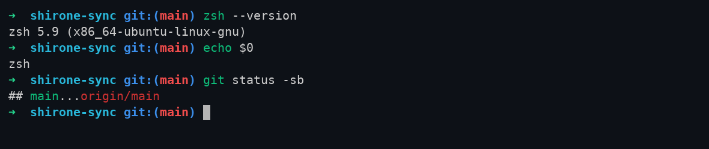

## 先说为什么要换

WSL 装好，打开终端，迎面而来的是 Bash。它能用，命令都能跑，但用久了有几个地方是真的难受：没有命令补全的「智能感」，输过的长命令下次还得一个字一个字敲，输错了也要等回车之后才知道。

Zsh 加上 Oh My Zsh 和两个插件，解决的就是这些日常小事：输一半命令，它把上次输过的整条命令淡淡地显示出来，按一下右方向键就补全；命令输错了，字符当场变红，不用等执行报错。这篇就把这套配置在 WSL 里从头装一遍，大概十分钟。

以下以 Ubuntu 为例，其他发行版把 `apt` 换成对应的包管理器就行。

## 第一步：装 Zsh，设成默认

先更新软件源，装 Zsh 和 git（后面装插件要用）：

```bash
sudo apt update
sudo apt install zsh git curl -y
zsh --version
```

能打印出版本号，比如 `zsh 5.9`，说明装好了。接着把它设成默认 shell：

```bash
chsh -s $(which zsh)
```

这条命令不会立刻有任何变化，它改的是「下次登录时用哪个 shell」。把所有 WSL 窗口关掉，在 PowerShell 或 CMD 里执行一次 `wsl --shutdown`，再重新打开终端。如果打开之后提示符变了样，`echo $0` 显示 `-zsh`，就成了。

**第一个坑在这里**：有些人 chsh 之后怎么重启都还是 Bash，多半是 Windows Terminal 的锅——你的终端配置文件里可能写死了启动命令。可以去 Windows Terminal 设置里看当前配置文件的「命令行」一栏，如果写的是 `bash` 或者某个 `.exe` 的固定路径，改成你的发行版默认启动方式，或者干脆新建一个配置文件。还有一个偷懒但可靠的办法：在 `~/.bashrc` 末尾加一行 `exec zsh`，让 Bash 启动后立刻转交 Zsh。能不用就不用，但被 chsh 折腾烦了的时候，它是真能救命。

## 第二步：装 Oh My Zsh

Oh My Zsh 是 Zsh 的配置框架，主题和插件都靠它管理。官方装法是一条命令：

```bash
sh -c "$(curl -fsSL https://raw.githubusercontent.com/ohmyzsh/ohmyzsh/master/tools/install.sh)"
```

装完终端会直接变成 Zsh 的样子，提示符前面多出一个箭头，这就是默认主题 `robbyrussell`。在 Git 仓库里，提示符还会带上当前分支名，省得你老去敲 `git status` 确认自己在哪条分支上。



*装好之后的样子：青色是目录，括号里是 Git 分支。这张和下面两张都是我在一台测试机上按本文步骤实际安装后截的图。*

**第二个坑是网络**：`raw.githubusercontent.com` 在国内经常连不上，命令卡在那里不动，或者报连接错误。两个办法：一是开代理之后再跑这条命令；二是走镜像，把安装脚本和仓库地址换成国内镜像站（比如 Gitee 上的 oh-my-zsh 镜像），装完再把 `~/.oh-my-zsh` 里远程仓库地址改回官方的，方便以后更新。网络的事没法一概而论，你那边能直连就当我没说。

装好后，所有配置都集中在一个文件里：`~/.zshrc`。以后改主题、加插件、写别名，都动它。

## 第三步：两个救命插件

Oh My Zsh 自带几百个插件，但真正每天都用得上的，是这两个外置插件。

**zsh-autosuggestions（自动建议）**：根据你的历史记录，在你打字时把可能的完整命令以灰色显示出来，按右方向键接受。

**zsh-syntax-highlighting（语法高亮）**：命令合法时是绿色，输错了立刻变红，路径、引号有没有闭合，一眼能看出来。

两个都要克隆到 Oh My Zsh 的自定义插件目录：

```bash
git clone https://github.com/zsh-users/zsh-autosuggestions ${ZSH_CUSTOM:-~/.oh-my-zsh/custom}/plugins/zsh-autosuggestions
git clone https://github.com/zsh-users/zsh-syntax-highlighting ${ZSH_CUSTOM:-~/.oh-my-zsh/custom}/plugins/zsh-syntax-highlighting
```

然后打开 `~/.zshrc`，找到 `plugins=(git)` 这一行，改成：

```bash
plugins=(git zsh-autosuggestions zsh-syntax-highlighting)
```

这里有个顺序讲究：**语法高亮必须放最后一个**，它要接管其他插件画完的命令行，放前面会失效或者警告。改完执行 `source ~/.zshrc`，或者干脆重开终端。随便敲一个以前用过的命令，灰色建议出现了，就说明装对了。


*自动建议的效果：白色是手敲的部分，灰色是它根据历史记录补出的后半条命令，按右方向键就整条接受。*


*语法高亮的效果：第一行把 `git` 打成了 `gti`，命令名立刻变红；第二行 `git` 是绿的，说明这个命令存在。后面灰色的 `-sb` 还是自动建议在工作。*

## 第四步（可选）：Powerlevel10k 主题和字体

默认主题够用，但如果你想要那种带 Git 分支、状态图标、两行信息的提示符，Powerlevel10k 是目前最好的选择：

```bash
git clone --depth=1 https://github.com/romkatv/powerlevel10k.git ${ZSH_CUSTOM:-$HOME/.oh-my-zsh/custom}/themes/powerlevel10k
```

把 `~/.zshrc` 里的 `ZSH_THEME` 改成 `"powerlevel10k/powerlevel10k"`，重开终端，它会启动一个配置向导，跟着选你喜欢的样式就行，以后想改再跑 `p10k configure`。

**第三个坑是字体，而且是 WSL 最容易栽的一个**：Powerlevel10k 的图标需要 Nerd Font 字体，而终端窗口是 Windows 那边的程序画的，所以字体要**装在 Windows 里**，不是装在 WSL 里。去 Nerd Fonts 官网下载 MesloLGS NF（这是 Powerlevel10k 官方推荐的字体），在 Windows 里双击安装，然后到 Windows Terminal 设置里，把当前配置文件的字体改成 `MesloLGS NF`。这一步没做，提示符上的图标就会显示成方框和问号，看起来像坏了，其实只是字体不对。

## 第五步：把 .zshrc 填得像个家

最后补一点让日子好过的配置，写进 `~/.zshrc` 末尾：

```bash
# 历史记录多留一点，多个窗口共享
HISTSIZE=10000
SAVEHIST=10000
setopt SHARE_HISTORY
setopt HIST_IGNORE_DUPS

# 常用别名
alias ll='ls -lah'
alias ..='cd ..'
alias gs='git status'

# 默认编辑器
export EDITOR='vim'
```

别名按自己的习惯加，别抄网上的几百行配置往里一塞——启动慢不说，出问题都不知道是哪一行干的。顺便说一句测速方法：`time zsh -i -c exit`，能看出 Zsh 启动要多久，超过半秒就该查查是不是插件装太多了。

## 最后一个坑：别用 Windows 编辑器改配置文件

这条和 Zsh 无关，但 WSL 用户特别容易中：不要用记事本之类的 Windows 程序去编辑 `~/.zshrc`。Windows 的换行符是 CRLF，带进 Linux 的配置文件里，轻则每行末尾多出一个看不见的 `\r`，重则 Zsh 启动时直接报错，错误信息还经常指不到真正的原因。改配置就在终端里用 vim 或 nano，或者用 VS Code 的 WSL 远程模式打开，那个是安全的。

## 写在最后

整套流程走下来：装 Zsh、设默认、Oh My Zsh、两个插件、可选的主题和字体。真正改变日常体验的其实是中间那两个插件，主题只是好看。配置这种东西一次弄好，能顺手用好几年，值得花这十分钟。

如果哪一步卡住了，先看报错，再对照上面几个坑：chsh 不生效看终端配置，图标是方框就补字体，启动报错先查换行符。大概率跑不出这三件事。
