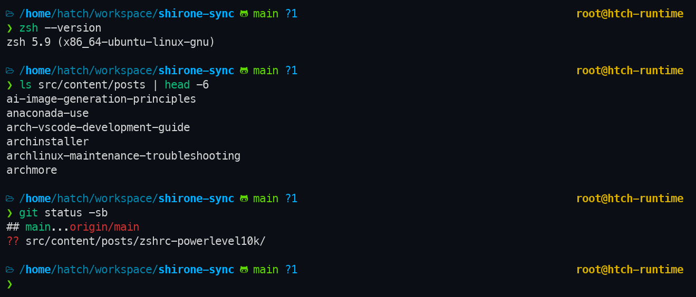

上一篇《给 WSL 装上 Zsh》把 Zsh 和 Oh My Zsh 装上了，默认的 robbyrussell 主题能用，但也就止步于能用。真正决定终端顺不顺手的，是 `~/.zshrc` 这个文件：主题、插件、历史记录、别名，全在里面。这一篇就把它掰开写。

先说清一个概念：`.zshrc` 本质上就是一个从上往下执行的 shell 脚本，没有什么魔法。所以顺序有讲究——有些东西必须放最前，有些必须放最后，后面会逐个讲到。我的习惯是分区块写、每块加一行注释，半年后回来改配置还能看懂自己当时在想什么。



*按本文配置实装后所截：两行提示符，第一行给信息、第二行才输入；分支后面的 `?1` 表示有一个未跟踪的文件。截图环境是 Linux 测试机，配置与 WSL 完全相同。*

## 主题：Powerlevel10k

安装就两步，克隆到 Oh My Zsh 的主题目录，再改 `.zshrc` 里的一行：

```bash
git clone --depth=1 https://github.com/romkatv/powerlevel10k.git \
  ${ZSH_CUSTOM:-$HOME/.oh-my-zsh/custom}/themes/powerlevel10k
```

```bash
ZSH_THEME="powerlevel10k/powerlevel10k"
```

重开终端，第一次启动会自动进入配置向导。向导第一件事是让你确认几个图标能不能正常显示——这就是上一篇《给 WSL 装上 Zsh》说的 Nerd Font 问题：字体装在 Windows 侧、Windows Terminal 里选好，向导这一步才过得去。Powerlevel10k 官方推荐的字体叫 MesloLGS NF，上面的截图用的就是它。

向导里我只说三个选择：

- **风格选 Lean**。它的提示符分两行：第一行放目录、Git 状态这些信息，第二行只留一个箭头等你输入。信息没少，输入区又干净，不像有些主题把一行塞得满满当当。
- **即时提示（Instant Prompt）选开**。原理是先把提示符画出来，插件在后台慢慢加载，体感上开终端几乎不用等。代价是它会往 `.zshrc` 最顶部塞一段它自己生成的代码，这段代码必须在文件最前面——这也是我说顺序有讲究的第一个例子。
- 其余选项（颜色深浅、显示时间还是不显示）按喜好来，选错了没关系，配置存在 `~/.p10k.zsh` 里，改几个变量就行，不用重跑向导。

Powerlevel10k 最值钱的其实不是好看，是它的 Git 状态：当前分支、有没有未跟踪或未暂存的改动、领先或落后远程几个提交，全在提示符上，扫一眼就知道仓库什么情况。截图里分支后面的 `?1`，就是在说这个仓库有一个还没纳入版本管理的文件——就是这篇文章所在的新目录，我截完图它才会被提交。

## 插件：分两类，别贪多

### Oh My Zsh 自带的，写上名字就能用

这几个不用安装，在 `.zshrc` 的 `plugins=(...)` 里写上名字即可，我天天用的就这六个：

- **git**：一堆 git 别名，`gst` 是 status、`gco` 是 checkout、`gcm` 是 commit -m。敲了几个月之后，手比脑子快。
- **z**：按使用频率跳目录。在某个目录待得多了，以后在任何地方敲 `z blog` 就能直达，不用写全路径。
- **extract**：`x 压缩包文件名`，zip、tar.gz、7z、rar 通吃，不用记每种格式的解压参数。
- **sudo**：命令都敲完了才发现要 root？连按两次 Esc，它自动在行首补上 sudo。
- **colored-man-pages**：man 手册带颜色，长文档能读下去了。
- **command-not-found**：命令打错或没装时，它会告诉你该装哪个包，而不是只甩一句 not found。

### 外部插件，就三个

这三个要克隆到插件目录（`~/.oh-my-zsh/custom/plugins/`），装法和上一篇的两个一样：

```bash
cd ~/.oh-my-zsh/custom/plugins
git clone https://github.com/zsh-users/zsh-autosuggestions
git clone https://github.com/zsh-users/zsh-completions
git clone https://github.com/zsh-users/zsh-syntax-highlighting
```

- **zsh-autosuggestions**：打字时根据历史记录在光标后面给出灰色建议，按 → 补全。上一篇详细介绍过，这里只补一个可调项：`ZSH_AUTOSUGGEST_STRATEGY=(history completion)`，让它同时参考补全结果，建议更聪明一点。
- **zsh-completions**：给几百个常用命令补上更完整的参数补全，很多命令装完系统只给文件名补全，这个插件补的是参数。
- **zsh-syntax-highlighting**：命令一边敲一边变色，对的绿、错的红。**它必须排在 `plugins=(...)` 的最后一个**，上一篇说过，这里再强调一次，放错位置轻则不生效、重则报错。

插件这件事上我吃过贪多的亏：列表拉到二十几个，启动明显变肉，还互相打架。现在的原则是每加一个先问自己，上周用过它没有？答不上来就不加。想知道自己的终端启动有多慢，跑一下 `time zsh -i -c exit`，我现在这份配置在测试机上大约 0.1 秒，超过半秒就该砍东西了。

还有一个可选进阶是 fzf：装上之后 Ctrl+R 搜历史命令可以模糊匹配，比按上箭头翻半天强得多。这篇不展开，感兴趣可以自己装，十分钟的事。

## 历史记录：三行设置，受益每天

```bash
HISTSIZE=10000
SAVEHIST=10000
setopt HIST_IGNORE_ALL_DUPS   # 同一条命令重复敲，只留一份
setopt HIST_REDUCE_BLANKS     # 多余的空格不进历史
setopt SHARE_HISTORY          # 多个终端窗口共享同一份历史
```

默认的历史条数太少，老命令很快被冲掉；`SHARE_HISTORY` 是这三行里最值的，在一个窗口里刚敲过的命令，另一个窗口按上箭头就能翻到。

## 完整 .zshrc，拿去改

下面这份就是上面截图用的配置，一行不差，加载无报错。可以整份抄走，再按自己的习惯删改：

```bash
# ===== Powerlevel10k 即时提示（必须放最前面）=====
if [[ -r "${XDG_CACHE_HOME:-$HOME/.cache}/p10k-instant-prompt-${(%):-%n}.zsh" ]]; then
  source "${XDG_CACHE_HOME:-$HOME/.cache}/p10k-instant-prompt-${(%):-%n}.zsh"
fi

# ===== Oh My Zsh =====
export ZSH="$HOME/.oh-my-zsh"
ZSH_THEME="powerlevel10k/powerlevel10k"
plugins=(
  git                 # git 别名：gst、gco、gcm…
  z                   # 按使用频率跳目录：z blog
  extract             # x 压缩包，万能解压
  sudo                # 连按两次 Esc 给命令补 sudo
  colored-man-pages   # man 手册带颜色
  command-not-found   # 命令打错时提示装哪个包
  zsh-completions     # 额外的补全定义
  zsh-autosuggestions # 按历史记录给灰色建议
  zsh-syntax-highlighting  # 语法高亮，必须放最后一个
)
source $ZSH/oh-my-zsh.sh

# ===== 历史记录 =====
HISTSIZE=10000
SAVEHIST=10000
setopt HIST_IGNORE_ALL_DUPS
setopt HIST_REDUCE_BLANKS
setopt SHARE_HISTORY

# ===== 个人设置 =====
export EDITOR='vim'
typeset -U path PATH          # PATH 自动去重，写错了也不怕重复
alias ll='ls -lah'
alias ..='cd ..'
alias ...='cd ../..'
mkcd() { mkdir -p "$1" && cd "$1" }   # 建目录并直接进去

# ===== Powerlevel10k 配置 =====
[[ ! -f ~/.p10k.zsh ]] || source ~/.p10k.zsh
```

几个小地方解释一下：`typeset -U path PATH` 让 PATH 自动去重，反复 source 配置文件也不会把 PATH 撑长；`mkcd` 是个小函数，建完目录直接进去，省一次 cd；编辑器那行按你的习惯换，平时用 VS Code 就写 `code`。

## 最后

配置文件没有标准答案，这份的价值在于每一行我都知道它在干什么。你抄的时候也建议这样：一行一行过，不懂的先删掉，缺什么再加回来。终端是每天要开几十次的东西，为它花一个小时，划算。
